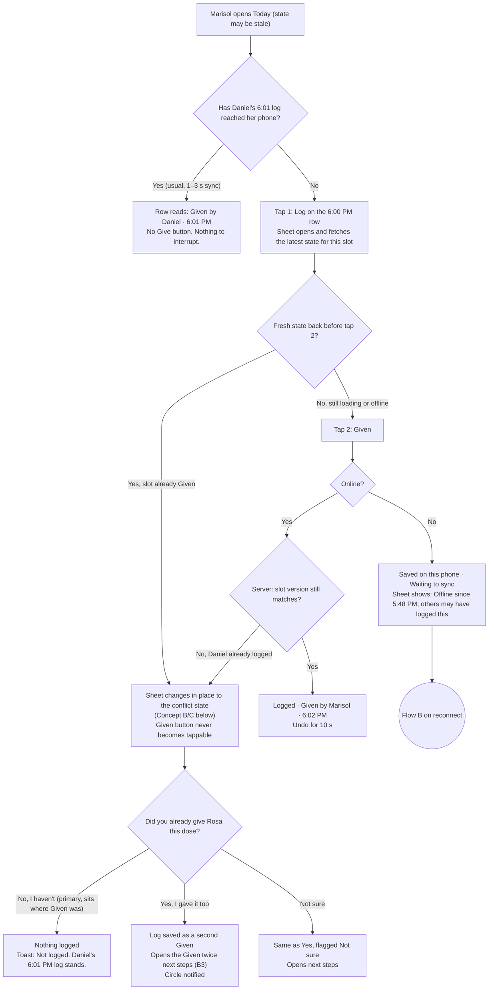
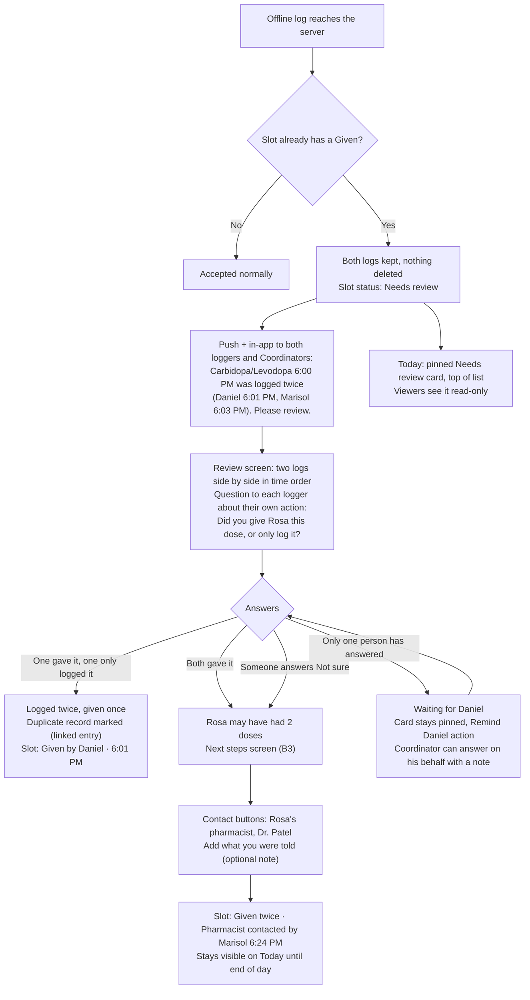
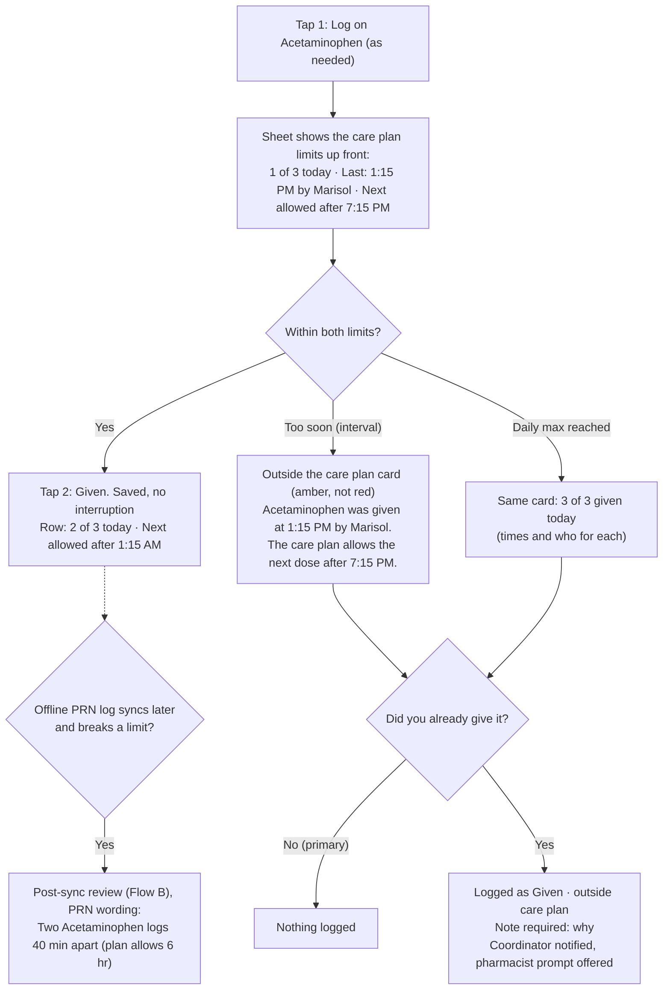

# Handoff · Journey 2: The double-dose moment
**First review pack** for Kinwell Labs: flows, conflict-warning concepts, how Today shows a resolved conflict, assumptions and questions.
Low fidelity on purpose. No visual design yet.

---

## 0. The core reframe (read this first)

**People usually log *after* they give, not before.** If Marisol has already put the pill in Rosa's hand when the app warns her, the warning can't prevent anything; all it does is record what happened. So the design has three layers of defence, and the interruption is the *last* one:

| Layer | When it acts | What it does |
|---|---|---|
| 1. **Accurate Today row** | Before anyone reaches for the pill organizer | A given dose stops showing a "Give" action and reads "Given by Daniel · 6:01 PM" instead. This prevents most conflicts silently. |
| 2. **Check-on-open** | When the Log sheet opens (tap 1) | The sheet fetches that dose's latest state and shows "Not given yet · checked just now". This teaches an "open → check → give → confirm" habit. It also shows live presence ("Daniel is logging this now"). |
| 3. **Conditional commit** | On "Given" (tap 2) | The server accepts the log only if the dose is still unlogged. If it isn't, the log isn't saved and the conflict interruption appears. |
| 4. **Post-sync resolution** | When an offline log arrives late | Both logs are kept. The circle answers "given twice or logged twice?" and gets a next step. |

Because layers 1–2 catch most cases quietly, the interruption in layer 3 stays **rare**. That rarity is our main defence against people learning to dismiss it.

**The one rule that never changes:** the app never stops someone from recording a dose that was actually given. Blocking the truth would corrupt the audit trail and hide a real double dose. The interruption asks a question; it doesn't refuse the log.

---

## 1. Model the flows rely on

- **Scheduled dose slot:** one occurrence, e.g. *Carbidopa/Levodopa · 6:00 PM · Tue Mar 10*. It expects at most **one** "Given". A second "Given" on the same slot is always a conflict, whatever the time gap.
- **Slot version:** every log bumps the slot's version. A commit carries the version the client last saw, so the server rejects stale writes (compare-and-set). This turns "both tapped at the same moment" into a clear first and second.
- **Presence (soft claim):** opening the Log sheet broadcasts "Daniel is logging" for up to 90 s, or until he closes the sheet. It's informational and never a lock, because a lock held by an offline phone would block care.
- **PRN (as needed):** has no slot. Each log is checked against the care plan's rules (max per day, minimum hours between doses). If both rules are met, it's not a conflict.
- **Non-given outcomes don't conflict.** If Daniel logged *Refused* or *Asleep, will try again*, Marisol giving it later is a legitimate retry. She sees an inline note, not an interruption.
  - **Exception: *Held per instructions*** (for example "Pulse 52") gets a calm one-tap acknowledgement before "Given" becomes available. Someone made a deliberate decision not to give, and the next person should see it.
- **Immutability:** a resolution never deletes anything. It adds a linked entry ("Marked as duplicate record by Marisol · 6:09 PM").

---

## 2. Flow A: Real-time conflict (we know in time)

Marisol arrives at 6:02 PM. Daniel logged at 6:01 PM, but Marisol's Today screen hasn't refreshed.



### Branches the brief calls out

**Both tap at the same moment.** Presence usually warns both people first. Each sheet shows the banner *"Daniel is logging this now"*, and Given stays available but with that banner above it. If both still commit, the server serialises them. The first log is saved and the second gets the interruption. Nobody can have two "Given" logs accepted silently.

**Presence but no commit.** Daniel opened the sheet and walked away. Presence expires after 90 s or when he closes the sheet, so it can't block anyone for long.

**Retry after Refused or Asleep.** The sheet shows the inline note *"Daniel logged Refused at 6:04 PM: 'Wants to wait until after dinner'"*. Given is enabled and there's no interruption.

**Retry after Held.** An amber card asks for one acknowledgement: *"Daniel held this at 6:04 PM: 'Pulse 52'. Check the care plan instructions before giving."* After **Got it**, Given becomes available. (Question 9 below asks whether this counts as clinical judgment.)

---

## 3. Flow B: Post-sync conflict (we find out afterwards)

Marisol was offline in Rosa's basement and logged at 6:03 PM. Daniel logged online at 6:01 PM. Her log syncs at 6:15 PM.



### B3: "Given twice" next steps (the medical-advice boundary)

The copy states facts and points people to someone qualified. It never interprets.

> **Rosa may have had two doses of Carbidopa/Levodopa 25/100 mg**
> Daniel at 6:01 PM · Marisol at 6:03 PM
>
> Contact Rosa's pharmacist or doctor and tell them what was given and when.
> **[ Call Northside Pharmacy ]**  **[ Call Dr. Patel's office ]**
> Questions to ask: *What should we do now? Should the next dose (8:00 AM tomorrow) change?*
> If Rosa seems unwell, call 911.
> *Handoff can't tell you what to do medically.*
>
> [ Add what the pharmacist said ] (optional, shared with the circle)

- **No wording like** "dangerous," "safe," "overdose" or "skip the next dose".
- **"Questions to ask"** gives prompts for the call, not answers.
- **The 911 line** is a standard emergency fallback, but it needs Legal sign-off (Question 3).

### Tone rules for both flows

- List the two logs **in time order**, with no "first" or "second" label and no "duplicate by Marisol".
- Each person answers **only for themselves**. Nobody is asked what someone else did.
- The headline describes the record: *"Two logs for the same dose"*. It doesn't describe a person.

---

## 4. Flow C: The PRN exception



- **Two PRN doses within limits are not a conflict, even from different people.** The row shows the count and the next allowed time, so nobody needs a warning to know where things stand.
- **A PRN limit breach is not a duplicate.** It gets its own copy ("outside the care plan") and amber styling. Red stays reserved for scheduled-dose conflicts and "given twice".
- **"Next allowed after"** is a calculation from rules the circle entered. It is not a recommendation. Using the care plan's own words keeps us clear of clinical language.

---

## 5. Conflict warning: three concepts (real-time)

The screen is 390 pt wide. In the sketches, `▓` marks the thumb zone and `[ ]` marks a ≥ 56 pt button.

### Concept A: "Hold on" full-screen takeover
```
┌────────────────────────────────┐
│                                │
│          ( Rosa photo )        │
│                                │
│   ⚠  Hold on.                  │
│   Daniel gave this 1 min ago.  │
│                                │
│   Carbidopa/Levodopa 25/100 mg │
│   6:00 PM dose                 │
│   ┌──────────────────────────┐ │
│   │ (DD) Given by Daniel     │ │
│   │      6:01 PM · Rosa's time│ │
│   └──────────────────────────┘ │
│                                │
│ ▓[   Don't log, I haven't    ]▓│
│ ▓[        given it           ]▓│
│    I gave it too  ·  Not sure  │
└────────────────────────────────┘
```
- **Pros:** unmissable, and the clearest choice when someone is rushing.
- **Cons:** heavy. It breaks context and feels like an error page. If false positives ever creep in, this is the version people learn to dismiss fastest.

### Concept B: The Log sheet changes in place *(recommended, combined with C)*
The same bottom sheet, after tap 1 or tap 2. The warning appears exactly where her eyes and thumb already are.
```
 Before (fresh fetch pending)        After (conflict found)
┌────────────────────────────────┐ ┌────────────────────────────────┐
│ Carbidopa/Levodopa 25/100 mg   │ │ Carbidopa/Levodopa 25/100 mg   │
│ 6:00 PM · Give 30 min before   │ │ 6:00 PM                        │
│ meals                          │ │┃⚠ Hold on. Daniel logged this  │
│ ◌ Checking for updates…        │ │┃  1 minute ago.               │
│                                │ │┃  (DD) Given · 6:01 PM         │
│                                │ │                                │
│                                │ │ Did you already give Rosa      │
│                                │ │ this dose?                     │
│ ▓[         ✓ Given          ]▓ │ │ ▓[ No, don't log it         ]▓ │
│ [ Skipped ]   [ Refused ]      │ │ [ Yes, I gave it too ]         │
│ Note · Time: now               │ │ Not sure                       │
└────────────────────────────────┘ └────────────────────────────────┘
```
- **Key detail:** the safe action ("No, don't log it") takes the exact position of "Given". A rushed double tap lands on the safe choice, never on "I gave it too".
- **Input guard:** the new buttons ignore taps for 600 ms after the change. With reduced motion on, the swap is instant, with no slide.
- **Feedback:** a warning haptic, plus a VoiceOver announcement: *"Hold on. Daniel logged this dose 1 minute ago."* Focus moves to the headline.
- **Pros:** contextual and calm, and its weight matches how rare the event is.
- **Cons:** a sheet is easier to swipe away. Swipe-down is treated as "No, don't log it", and a toast confirms *"Not logged."*

### Concept C: Question-led check (no warning banner)
```
┌────────────────────────────────┐
│ Daniel gave Rosa's 6:00 PM     │
│ Carbidopa/Levodopa at 6:01 PM. │
│                                │
│ Did you already give it?       │
│                                │
│ ▓[ No, I haven't            ]▓ │
│ [ Yes, I gave it too        ]  │
│ [ Not sure                  ]  │
└────────────────────────────────┘
```
- **Pros:** it forces reading, because you can't answer without understanding the question. It also covers the "I already gave it" case directly, which A and B treat as secondary.
- **Cons:** a question with three equal options is slower to scan, and it has the least urgency.

**Recommendation:** **B's container and placement with C's question.** The full-screen treatment (A) is reserved for the *"Rosa may have had two doses"* next-steps screen, the one moment that should feel bigger. To test: A vs. B+C on time-to-correct-decision and on whether a rushed participant ever taps "I gave it too" by accident.

---

## 6. Today: how a conflict shows (needs review, then resolved)

```
 Needs review (pinned above everything)    Resolved: logged twice, given once
┌────────────────────────────────┐ ┌────────────────────────────────┐
│ Rosa · Tue Mar 10 · 6:15 PM CT │ │ Rosa · Tue Mar 10 · 6:30 PM CT │
│┏━━━━━━━━━━━━━━━━━━━━━━━━━━━━━┓ │ │                                │
│┃⚠ NEEDS REVIEW                ┃ │ │ ✓ 6:00 PM Carbidopa/Levodopa   │
│┃ Carbidopa/Levodopa 6:00 PM   ┃ │ │   Given by Daniel · 6:01 PM    │
│┃ was logged twice.            ┃ │ │   ⓘ Logged twice · given once ›│
│┃ (DD) 6:01  (MD) 6:03         ┃ │ │                                │
│┃ Waiting for: Daniel          ┃ │ │ ○ 9:00 PM Artificial tears     │
│┃ [ Review ]                   ┃ │ │                                │
│┗━━━━━━━━━━━━━━━━━━━━━━━━━━━━━┛ │ │                                │
│ ◆ 2:00 PM Furosemide           │ │ Resolved: given twice          │
│   Not logged · 4 hr 15 min over│ │ ✓✓ 6:00 PM Carbidopa/Levodopa  │
│ …                              │ │    Given twice · 6:01, 6:03 PM │
└────────────────────────────────┘ │    Pharmacist contacted by     │
                                   │    Marisol · 6:24 PM         › │
                                   └────────────────────────────────┘
```

- **Needs review** can't be dismissed. It disappears only when the question is answered. It has a filled warning icon, a heavy border and an uppercase label, so it doesn't rely on color.
- **Logged twice, given once** goes back to a normal "done" row. A quiet ⓘ line links to the audit trail and doesn't leave a mark on anyone.
- **Given twice** gets a distinct double-check glyph and stays visible for the rest of Rosa's day. That way Marisol, checking in bed at 10:30 PM (Journey 3), sees it and sees that the pharmacist was contacted.
- **Times are labelled with Rosa's timezone (CT)** in the header. Teresa in Phoenix sees the same times with "Rosa's time".

---

## 7. Assumptions (please confirm or correct)

1. **Logging happens around the moment of giving, not hours later.** Late logs ("given at 6:00, logged 6:22") are supported with an editable time, and they still conflict-check against the slot.
2. **A scheduled slot means exactly one dose.** "Take 2 tablets" is one dose with quantity 2, not two logs.
3. **The backend can do compare-and-set on a slot and broadcast short-lived presence.** It's needed for layer 3 and the "Daniel is logging" banner. 1–3 s sync is fine for this.
4. **The care plan can store pharmacist and doctor contacts.** That's a small addition to Create circle / Care plan, and it's needed for the next-steps screen.
5. **Notifications reach the two loggers plus Coordinators, not Viewers.** Teresa sees the review card read-only and isn't asked to act.
6. **Conflict detection is server-side, so it works even when push is off.** The pinned Today card is the fallback and doesn't depend on notifications.
7. **Offline logging is never blocked.** We warn ("Others may have logged this") and accept, because refusing to record a given dose is worse.

## 8. Hypotheses to test

- **H1:** Check-on-open (layer 2) changes behaviour. Participants who see "Not given yet · checked just now" open the app *before* giving more often than those who don't.
- **H2:** Placing the safe action under the thumb reduces accidental "I gave it too" taps to ~0 in rushed scenarios.
- **H3:** With conflicts limited to genuine cases, 90%+ of testers correctly state who gave the dose and when after seeing the warning (brief target).
- **H4:** Asking each person only about their own action produces less defensiveness than a shared "what happened?" form (post-test interviews with Marisol- and Daniel-type participants).
- **H5:** Precious-type participants trust the conditional-commit model ("your log wasn't saved because…") as protection rather than as an error.

## 9. Questions for Kinwell

1. **Late logs:** how late is too late? If Marisol logs a 6:00 PM dose at 11:00 PM, should we ask "When did you give it?" before saving?
2. **Who can resolve:** can a Coordinator answer for an absent caregiver, or must each logger answer for themselves? (Proposed: the Coordinator can, with a required note.)
3. **Legal:** is a "call 911 if Rosa seems unwell" line acceptable, or does even that count as clinical judgment? Is Poison Control (1-800-222-1222) acceptable as a contact if no pharmacist is on file?
4. **Escalation:** if a "given twice" stays unacknowledged for X minutes, should we escalate (a repeat push to all Caregivers)? What's X?
5. **Paid aides:** for agency aides like Precious, should a conflict involving her also notify the agency? (This touches the future agency-linking tier.)
6. **PRN overrides:** should "Given outside care plan" require a note, or is a note optional? (Proposed: required. It protects whoever gave it.)
7. **Scheduled extra doses:** can a doctor-ordered one-off extra dose of a scheduled medication exist, or is that out of scope for the MVP?
8. **Presence privacy:** is broadcasting "Daniel is logging this now" acceptable to all roles, including Viewers?
9. **Held by someone else:** for "Held per instructions" by someone else, should the next person be interrupted (proposed: one-tap acknowledgement) or just informed?

## 10. Scope note

The brief asks for "Give" on the row. I'm proposing that tap 1 **opens the sheet** rather than logging directly. It still meets the 2-tap target (tap 1 opens, tap 2 confirms Given), and that brief moment on the sheet is what makes layer 2 possible. A true one-tap "Given" from the row would be faster but would skip the fresh check. I'd test both, but I recommend the 2-tap path for scheduled medications.
