# Web Design Inspiration Report: 20 Exceptional Websites

**Research date:** 15 October 2026 (UTC)  
**Scope:** 20 live websites across 11+ countries of origin, 15+ industries, and a deliberate spread of styles, from immersive WebGL to plain, fast HTML.

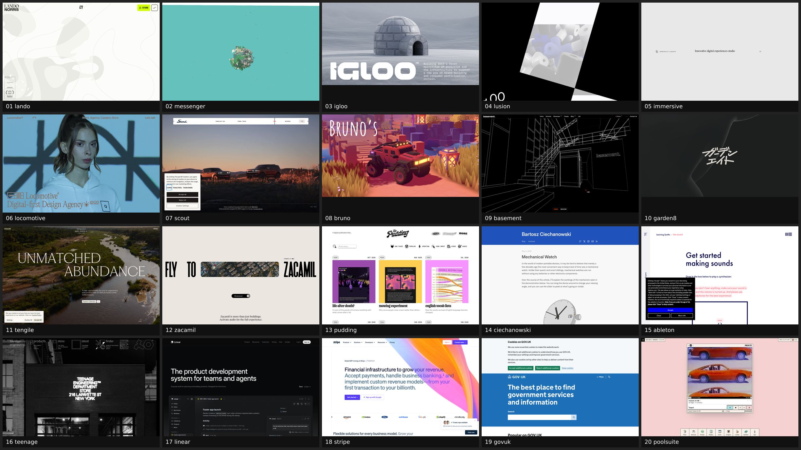

---

## How to read this report

Every claim carries one of three labels:

| Label | Meaning |
|---|---|
| **Observed** | I saw it directly in a headless Chrome session on the research date, or in the page's HTML/DOM. |
| **Source** | Taken from an award platform's page (mostly Awwwards), the creator's own site, or an official announcement. Linked in [Sources](#sources). |
| **Unverified** | Reported somewhere (LinkedIn posts, press, a research summary) but not confirmed against a primary source. Treat with caution. |

### Method and limits

- **Captures.** Chrome 1440×900 (desktop) and 390×844 at 2× with an iPhone user-agent (mobile emulation, not a real device). Each page was given 8–40 seconds to settle.
- **WebGL caveat (important).** The sandbox had no GPU, so WebGL ran on a software renderer (SwiftShader). Heavy 3D sites (Igloo, Bruno Simon, Garden Eight, Lando Norris's 3D helmet) didn't finish rendering. **This tells you nothing about their speed on a real phone or laptop.** Where a capture failed, I used the site's own social-sharing (Open Graph) image and labelled it **"site-provided image"**.
- **DOM checks** (automated, per page): `<h1>` count, images missing `alt`, `<nav>`/`<main>` landmarks, skip link, unnamed buttons/links, whether zoom is disabled in the viewport tag, whether any CSS responds to `prefers-reduced-motion`, horizontal overflow on mobile, and resource transfer size.
  - **Transfer sizes are lower bounds.** Cross-origin assets often report 0 bytes, and measurement stopped at the capture time. I quote them only where they're clearly large.
- **Not done:** no Lighthouse or Core Web Vitals on real hardware, no screen-reader walkthrough, no colour-contrast measurement. Accessibility notes are signals to investigate, not audit verdicts.
- **Award scores.** Awwwards publishes jury sub-scores (Design 40%, Usability 30%, Creativity 20%, Content 10%). I quote the **Usability** sub-score because it's the most useful counterweight to visual spectacle.

---

## 1. Comparison table

Key: **3D** = WebGL-led experience. **Zoom off** = the viewport tag blocks pinch-zoom (an accessibility problem; WCAG 1.4.4). **RM** = CSS that responds to `prefers-reduced-motion` was detected.

| # | Site | Origin (studio) | Industry | Style | Signature idea | Weight | Mobile (observed) | Accessibility flags (observed) | Headline award (source) |
|---|---|---|---|---|---|---|---|---|---|
| 1 | [Lando Norris](https://landonorris.com) | UK (OFF+BRAND) | Sport / athlete | Editorial + 3D | Serif/grotesk wordmark, topographic lines, "next race" card | Medium | Re-stacks cleanly | Images have alt; no skip link; no RM | Awwwards **SOTY 2025** |
| 2 | [Messenger](https://messenger.abeto.co) | US (abeto) | Experimental / game | Toon-shaded 3D | A tiny multiplayer planet you deliver mail on | Heavy (≥5.7 MB) | Planet renders | **No DOM text at all** | Awwwards **Dev SOTY 2025** |
| 3 | [Igloo Inc](https://www.igloo.inc) | US (abeto + Bureaux) | Web3 / venture | Icy 3D + mono type | Ice-and-snow world as company metaphor | Very heavy (≥15 MB) | Didn't render here | Empty `<body>`; no headings or text | Awwwards **SOTY 2024** |
| 4 | [Lusion](https://lusion.co) | UK | Creative studio | 3D + Swiss | Physics "toy box" hero, numeric loader | Medium–heavy | Loader only here | **Zoom off**; no nav/main landmarks | Awwwards **SOTY 2023** |
| 5 | [Immersive Garden](https://immersive-g.com) | France | Creative studio (luxury) | Luxury minimal | Serif restraint around heavy WebGL case studies | Very heavy (≥21 MB) | Loader | **Zoom off**; 39/39 images lack alt | Awwwards Agency of the Year 2025 |
| 6 | [Locomotive](https://locomotive.ca/en) | Canada | Creative agency | Editorial / video | Serif + mono over full-bleed video | Medium | Headline over busy video | RM present; landmarks present | Awwwards Agency of the Year 2024 |
| 7 | [Scout Motors](https://www.scoutmotors.com) | US (Locomotive) | Automotive | Cinematic heritage | Dusk landscape video, floating segmented nav | Medium | Cookie modal covers hero | 17 unnamed controls; RM present | Awwwards **E-commerce of the Year 2025** |
| 8 | [Bruno Simon](https://bruno-simon.com) | France | Developer portfolio | Game world | Drive a toy truck through the portfolio | Heavy (≥7 MB) | Touch controls documented | No h1; 41/44 images lack alt | Awwwards SOTM Jan 2026 (+2019 SOTM) |
| 9 | [basement.studio](https://basement.studio) | Argentina | Creative studio | Wireframe 3D + brutal type | **HUMAN / MACHINE** toggle → plain-HTML twin | Heavy (≥16 MB) | Toggle overlaps headline | RM present; landmarks present | Awwwards SOTD Apr 2025 |
| 10 | [Garden Eight](https://garden-eight.com) | Japan | Creative studio | Quiet 3D, katakana mark | Bilingual (EN/JA) minimalist studio site | Medium | Didn't render here | **Zoom off** | Awwwards SOTD 2022 & 2017 |
| 11 | [Tengile MalaMala](https://tengilemalamala.com) | South Africa (DashDigital) | Hospitality / conservation | Warm luxury editorial | Aerial river film + thin serif "UNMATCHED ABUNDANCE" | Light–medium | Excellent | **Skip link**; full landmarks; images have alt | Awwwards SOTD 3 Oct 2026 |
| 12 | [Colonia Zacamil](https://coloniazacamil.com) | El Salvador project (Adoratorio) | Civic / public art | Condensed type + 3D map | "FLY TO ZACAMIL" — map of murals with past/present switch | Heavy (≥5.7 MB) | Type re-stacks well | **Zoom off**; no headings | Awwwards SOTD 1 Oct 2026 |
| 13 | [The Pudding](https://pudding.cool) | US | Data journalism | Playful editorial | Numbered "issues," sticker-like nav icons | Medium | Very good | No h1 on index; RM present; skip link | Webby Honoree 2019 |
| 14 | [Bartosz Ciechanowski](https://ciechanow.ski/mechanical-watch/) | Poland (solo) | Education / explainers | Plain reading layout + 3D figures | Dozens of draggable, inline interactive diagrams | Medium (~2 MB) | Excellent reading | 13/13 images without alt; no landmarks | None verified |
| 15 | [Ableton Learning Synths](https://learningsynths.ableton.com) | Germany | Music education | Flat, colourful, didactic | Playable synth in the first viewport | Light (~1 MB) | "Unmute your device" prompt | **Zoom off** | Learning Music: Awwwards HM 2017 |
| 16 | [Teenage Engineering](https://teenage.engineering) | Sweden | Consumer electronics | Monochrome industrial | Lowercase nav with pictograms + Japanese micro-copy | Light | Minimal, clean | **Zoom off**; RM present | None verified |
| 17 | [Linear](https://linear.app) | US | B2B SaaS | Dark, precise | The real product UI *is* the hero | Light | Excellent | Skip link; landmarks; RM present | None verified |
| 18 | [Stripe](https://stripe.com) | US | Fintech | Gradient + clarity | Animated colour ribbon + live "GDP on Stripe" counter | Medium | Excellent | Two h1s; no RM detected | (Stripe.com: Awwwards nominee) |
| 19 | [GOV.UK](https://www.gov.uk) | UK (GDS) | Government | Utilitarian | Search-first, one typeface, one blue | Lightest measured (≥0.2 MB) | Excellent | Skip link; landmarks; RM; balanced cookie choice | Design of the Year 2013 (Design Museum) |
| 20 | [Poolsuite](https://poolsuite.net) | Unverified (Marty Bell) | Music / lifestyle | Retro OS / nostalgia | 1990s desktop as a music app | Medium (~4 MB) | **Player window clipped** | 73/133 images lack alt; no h1 | Product Hunt Golden Kitty 2020 (app) |

> **Excluded: Opal Tadpole** (Awwwards E-commerce of the Year 2024). `opalcamera.com/tadpole` now redirects to `op.al`, which shows a company story page ("the table"). Every Tadpole path I tried returned 404. It's no longer accessible, so it isn't reviewed.

---

## 2. Individual reviews

### Immersive & 3D-led

---

### 1. Lando Norris — [landonorris.com](https://landonorris.com)

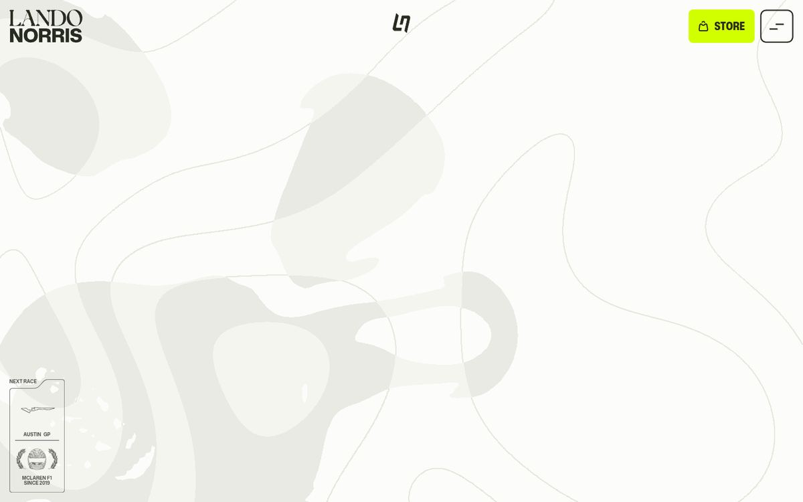
*Observed capture, desktop. The 3D helmet layer didn't render under software WebGL; only the topographic layer is shown.* 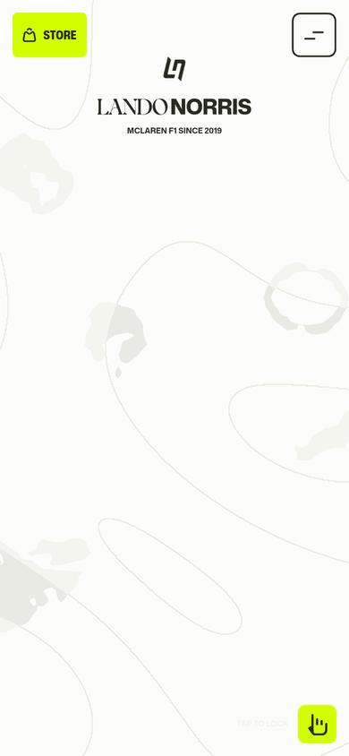

**Purpose & industry:** Personal brand, fan hub and store for the McLaren Formula 1 driver. Sport and athlete.

**What makes it distinctive**
- **Typography (observed):** The wordmark pairs a high-contrast serif "LANDO" with a heavy grotesk "NORRIS". The DOM lists *Mona Sans Variable* and *Brier*; I infer Brier is the serif. It reads as part fashion magazine, part race livery.
- **Colour (observed):** Off-white canvas with grey topographic contour lines, plus a single acid-lime accent used only for the STORE button. One accent, used once.
- **Content as interface (observed):** A small "NEXT RACE · AUSTIN GP" card with a track outline and a "McLaren F1 since 2019" laurel. It gives the site a live, seasonal reason to revisit.
- **Storytelling (observed):** Sections run "Message from Lando" → On Track → Off Track → Helmets → Hall of Fame → Store → Partners → Socials. That's a clear narrative arc from person to performance to commerce.

**User experience (observed)**
- Navigation: Home, On Track, Off Track, Calendar, Store, behind a menu button. The persistent STORE CTA is never more than a glance away.
- Mobile: the wordmark re-centres, CTA buttons become large thumb targets, and a pointer/hand hint appears bottom-right.
- 1 `<h1>`, 40 headings, all 133 images carry `alt`, `<main>` present. Missing: skip link, `<nav>` landmark, reduced-motion handling.
- 21 `<canvas>` elements on one page, which is a lot of animated layers for low-end phones. I couldn't measure the real-device impact.

**Design lessons**
- Pair one expressive serif with one sturdy grotesk to give a personal brand both personality and punch.
- Reserve your brightest colour for the action you most want taken.
- Put a time-sensitive "now" module (next race, next event, next drop) in the first viewport.

**Credits & awards (source):** OFF+BRAND (London). Awwwards SOTD 17 Nov 2025: 8.18 overall, Usability 7.90, Creativity 8.71. Awwwards **Site of the Year 2025** and **Users' Choice 2025**. Awwwards lists Webflow, GSAP and WebGL.

---

### 2. Messenger — [messenger.abeto.co](https://messenger.abeto.co)

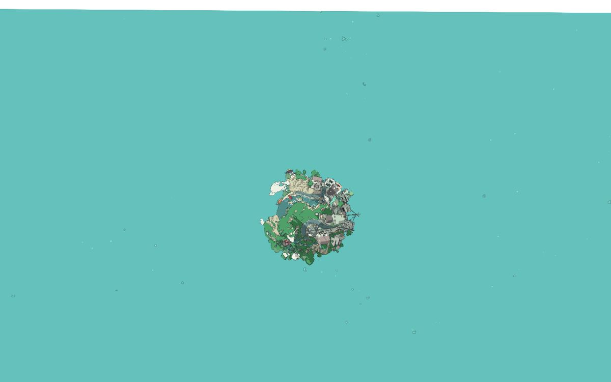
*Observed capture: the planet after the intro transition.* 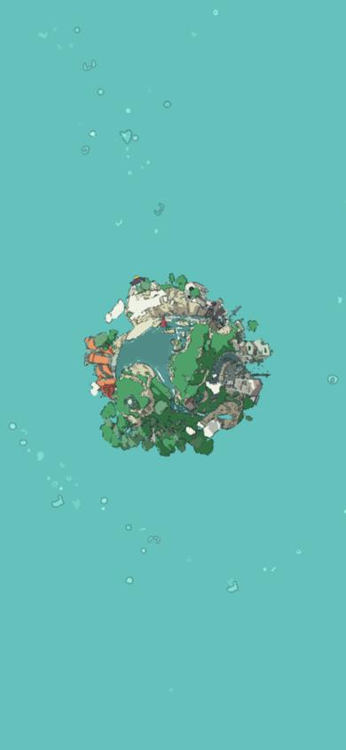

**Purpose & industry:** A self-initiated browser game and experiment ("It's a small planet, but someone's gotta make the deliveries" — page description). Experimental, entertainment, studio showcase.

**What makes it distinctive**
- **Art direction (observed):** A cel-shaded miniature planet of houses, trees and harbours floating in flat teal. It's illustrated, not photoreal, which keeps the scene readable at tiny sizes and is kinder to GPUs.
- **Transitions (observed):** The intro is a hard diagonal teal wipe, then a pull-in on the planet. It's simple geometry, not a spinner.
- **Interaction (source):** Awwwards lists WebSockets, so other visitors share the world in real time.

**User experience**
- Observed: the HTML ships an empty `<body>` and a single JS module. **No text exists in the DOM** (0 characters, 0 headings), so screen readers and search engines get nothing.
- Observed: it ran on mobile emulation, with the planet rendering at 390 px.
- Source: Awwwards Usability 7.46 is its lowest sub-score.

**Design lessons**
- A stylised, low-poly or toon look scales across devices better than photorealism, and reads as more "designed."
- Small worlds beat big ones: a planet you can see whole orients people instantly.
- If you build a canvas-only experience, ship a text layer (title, instructions, about) in HTML alongside it.

**Credits & awards (source):** abeto (United States, per its Awwwards profile). Awwwards SOTD 10 Nov 2025 (7.92). **Developer Site of the Year 2025.** Stack per Awwwards: Three.js, WebGL, WebSockets. Released Sep 2025 (from research summary; unverified).

---

### 3. Igloo Inc — [igloo.inc](https://www.igloo.inc)

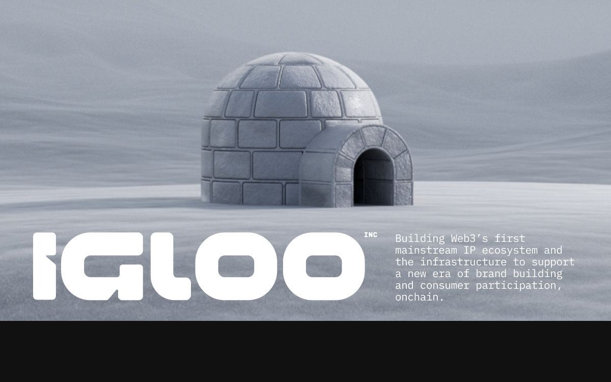
*Site-provided image (Open Graph). My capture showed only the loader on grey: a text-glyph progress bar `-=+=----==`.*

**Purpose & industry:** Corporate site for Igloo Inc., a consumer-crypto company (meta description: "create the largest onchain community"). Its link to the Pudgy Penguins brand is widely reported but not verified here. Web3 and venture.

**What makes it distinctive**
- **Metaphor (observed + source):** The whole brand world is ice. A single igloo in a snowfield, with frosted materials and a cold blue-grey palette.
- **Typography (observed, via preview):** Ultra-rounded geometric display type ("IGLOO") against small monospace body copy, which gives a "terminal" crypto voice.
- **Loader (observed):** An ASCII-style progress bar. It's on-brand, low-cost, and more characterful than a spinner.

**User experience (observed)**
- HTML is just a `<title>`, meta tags and one script. The `<body>` is empty: no headings, no links, no text in the DOM even after 35 seconds.
- ≥15 MB transferred within the first 35 seconds on desktop. That's significant on mobile data.
- I couldn't assess navigation because the scene never rendered without a GPU.

**Design lessons**
- One strong physical metaphor (ice, glass, paper) can carry an entire identity.
- Treat the loader as the first scene, not dead time.
- **Caution:** award-winning ≠ inclusive. Don't copy the empty-HTML architecture; render core copy and links as real HTML.

**Credits & awards (source):** abeto and Bureaux. Awwwards SOTD 23 Jul 2024 (7.92; Usability 7.50). **Site of the Year 2024** and **Developer Site of the Year 2024**.

---

### 4. Lusion — [lusion.co](https://lusion.co)

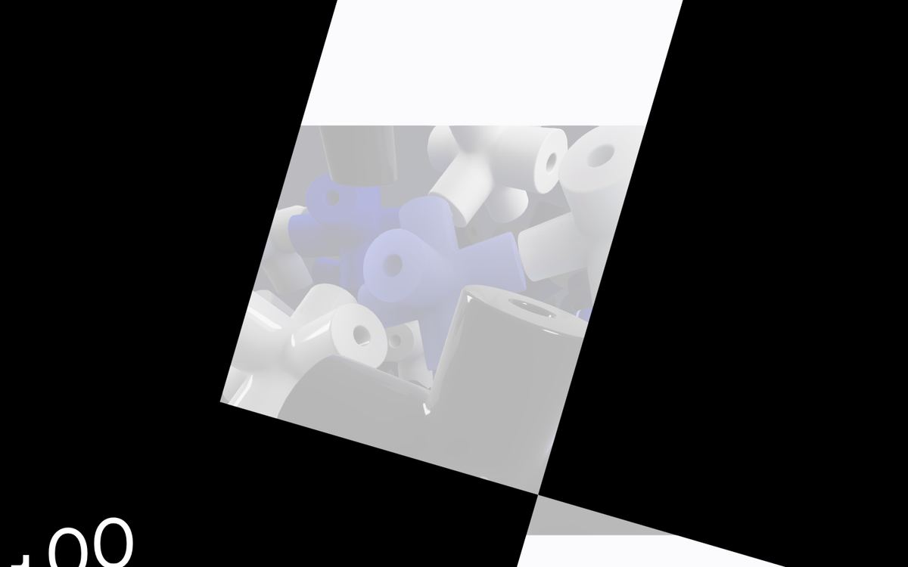
*Observed capture, mid-transition: tumbling white and blue 3D objects inside a skewed panel; large numeric loader bottom-left.*

**Purpose & industry:** Portfolio for a 3D and interactive web studio in Bristol, UK (footer). Creative services.

**What makes it distinctive**
- **3D as material, not decoration (observed):** Glossy, toy-like 3D pieces in white and periwinkle tumble through a slanted window. It's playful physics that says "we build this" without a sentence.
- **Loader as typography (observed):** A huge counter ("014…") set in *Aeonik*, cropped at the bottom-left of the viewport.
- **Copy (observed):** "We create 3D visual storytelling and interactive web experiences that help brands stand out." The rest is short, confident text with 12 featured projects (Oryzo AI, Devin AI, Porsche: Dream Machine…).

**User experience (observed)**
- **Viewport disables pinch-zoom** (`maximum-scale=1, user-scalable=no`).
- No `<nav>` or `<main>` landmarks, and 5 unnamed controls.
- On mobile emulation only the loader appeared within the capture window, so mobile behaviour is unverified.
- The page has real HTML text (≈2,800 characters, 1 `<h1>`), so it isn't canvas-only.

**Design lessons**
- Show capability, then explain it: a 5-second interactive demo outperforms a paragraph of claims.
- Oversized numerals make a loader feel intentional.
- Keep text in HTML even when the hero is all WebGL.

**Credits & awards (source):** Lusion. Awwwards SOTD 2 Oct 2023 (8.25 overall; Usability 7.95). **Site of the Year 2023** and Developer SOTY 2023. CSSDA Website of the Year 2023 (from a CSSDA page snippet; partially verified). FWA SOTY and Cannes Lions Silver/Bronze 2024: **unverified** (LinkedIn posts only).

---

### 5. Immersive Garden — [immersive-g.com](https://immersive-g.com)

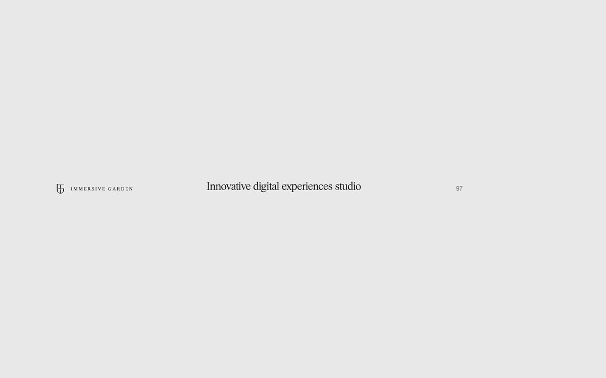
*Observed capture: the preloader. Logo, one serif line "Innovative digital experiences studio", and a counter at 97.*

**Purpose & industry:** Studio portfolio for a Paris agency known for luxury work (Louis Vuitton, Cartier, Dior, Omega, Longines). Creative services, luxury.

**What makes it distinctive**
- **Restraint (observed):** Pale grey ground, *PSTimes* serif paired with Helvetica Neue, generous empty space. The chrome is quiet so the case-study visuals can be loud.
- **Client-led storytelling (observed):** The homepage is essentially a list of 18 projects. Each has a one-line story and a category tag (Web Experience / E-Shop / Corporate).
- **Sound toggle (observed):** An "Off / On" audio control, opt-in rather than autoplay.

**User experience (observed)**
- **Zoom disabled** in the viewport tag.
- **All 39 images lack `alt` attributes** (19/19 on mobile), with 7 unnamed controls and no `<main>`.
- ≥21 MB transferred within ~35 seconds, the heaviest page in this set.
- The capture stayed on the preloader, so scroll behaviour is unverified.

**Design lessons**
- Luxury reads as *what you leave out*: one serif, one sans, one neutral, lots of space.
- A homepage can simply be "the work, with one sentence each."
- **Counter-lesson:** this is the clearest example here of beautiful-but-heavy. Budget your media.

**Credits & awards (source):** Immersive Garden, Paris (founded 2014, per its Awwwards profile). Awwwards **Agency of the Year 2025** and **Studio of the Year 2024**. CSSDA Agency of the Year 2024 (research summary). Awards for this specific site version weren't verified.

---

### 6. Locomotive — [locomotive.ca](https://locomotive.ca/en)

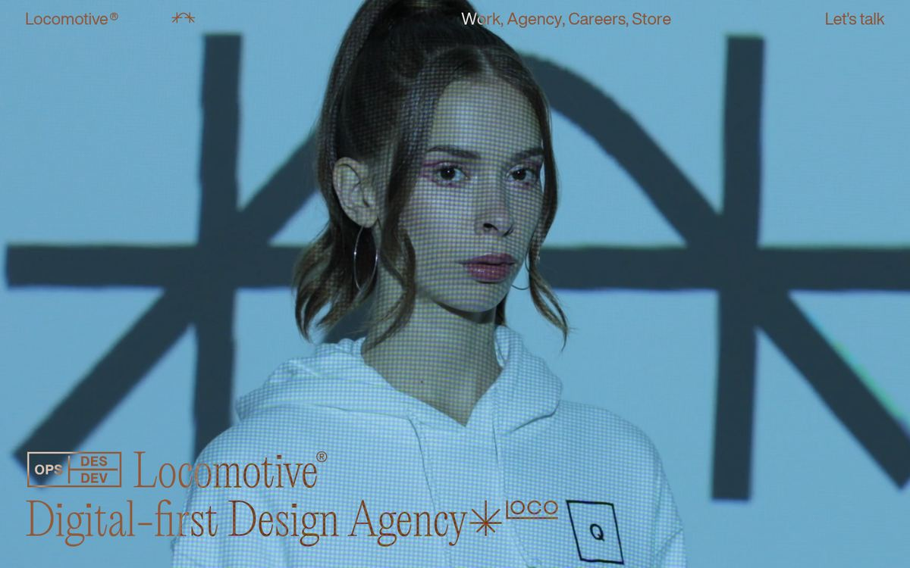
*Observed captures (desktop and mobile): full-bleed video with a serif-and-mono headline.* 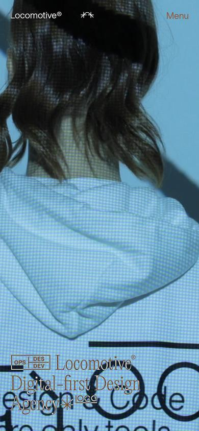

**Purpose & industry:** Portfolio for a Montréal "digital-first design agency." Creative services.

**What makes it distinctive**
- **Typography (observed):** A condensed editorial serif ("Digital-first Design Agency✳") in warm copper over cool blue video. Brand fonts in the DOM: *LocomotiveNew* and *Helvetica Now Display*.
- **Brand system (observed):** A small "OPS | DES | DEV" grid logo-mark and an asterisk motif. The social image repeats "Design & Code are only Tools of Expression" as stuttering, cascading type.
- **Projected-light video (observed):** Logos are projected onto people, a tactile, physical take on a digital brand.

**User experience (observed)**
- Navigation is a single line: "Work, Agency, Careers, Store" plus "Let's talk." Very short.
- **Reduced-motion CSS is present**, as are `<main>` and three `<nav>` landmarks.
- **Mobile concern:** the copper headline sits over busy video with large type behind it, and legibility drops noticeably at 390 px.
- WebFetch was blocked (HTTP 403), so I relied on rendered captures.

**Design lessons**
- A warm accent over a cool image is an instant, ownable contrast.
- Write navigation as a sentence ("Work, Agency, Careers, Store").
- Check text-over-video at mobile widths; add a scrim or move text off the video when it gets busy.

**Credits & awards (source):** Locomotive, Montréal. Awwwards **Agency of the Year 2024** (and 2023, per research summary). Its profile lists 92 SOTDs. Awards for this specific site build weren't verified.

---

### 7. Scout Motors — [scoutmotors.com](https://www.scoutmotors.com)

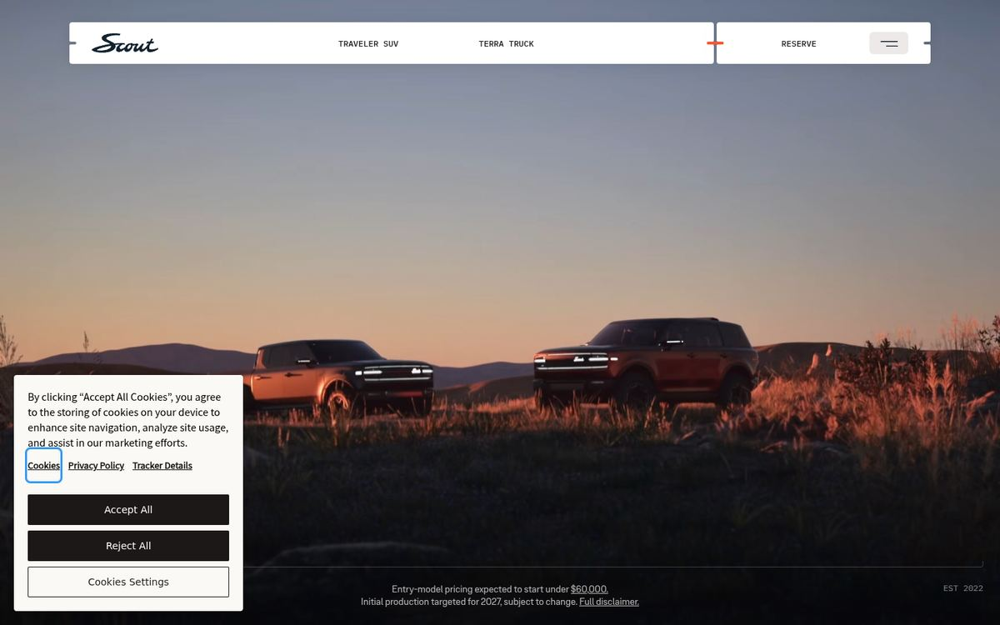
*Observed captures: desktop and mobile.* 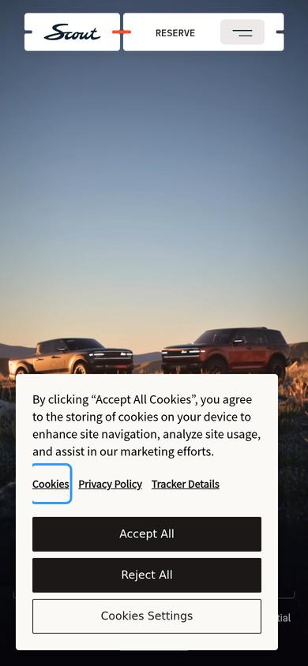

**Purpose & industry:** Launch and reservation site for the revived Scout SUV and truck brand (Volkswagen Group). Automotive and e-commerce.

**What makes it distinctive**
- **Cinematic heritage (observed):** A full-bleed dusk video of the Traveler and Terra on grassland. The hero runs about two viewports before the first headline, "Scouts always come back."
- **Navigation as an object (observed):** A floating, segmented white nav bar with a small red "+" joint. It's industrial, like a dashboard trim piece.
- **Story structure (observed):** Present (reserve) → past (1961 International Harvester) → "An icon from day one" numbered 01–12 → reveal event → the duo → manufacturing (Detroit, South Carolina).

**User experience (observed)**
- Honest disclosures sit right under the hero: "Entry-model pricing expected to start under $60,000. Initial production targeted for 2027, subject to change."
- The cookie dialog gives **equal-weight "Accept All" and "Reject All" buttons**, which is good practice. But on mobile the dialog covers most of the hero.
- Built with Astro (asset paths). Reduced-motion CSS present; `<main>` and two `<nav>` landmarks.
- 17 unnamed controls (icon buttons without accessible names).

**Design lessons**
- Heritage brands can tell past and future in one scroll: lead with the new product, then earn it with history.
- Put legal and pricing caveats where the claim is made, not in a footer.
- Equal-weight consent buttons build trust, but size the banner so it doesn't bury your hero on mobile.

**Credits & awards (source):** Locomotive with Scout's in-house team. Awwwards SOTD 16 Jan 2025 (7.60; Usability 7.27). **E-commerce Site of the Year 2025.** Webby Honoree and Idéa 2025 Silver were in the research summary; I didn't recheck them.

---

### 8. Bruno Simon — [bruno-simon.com](https://bruno-simon.com)

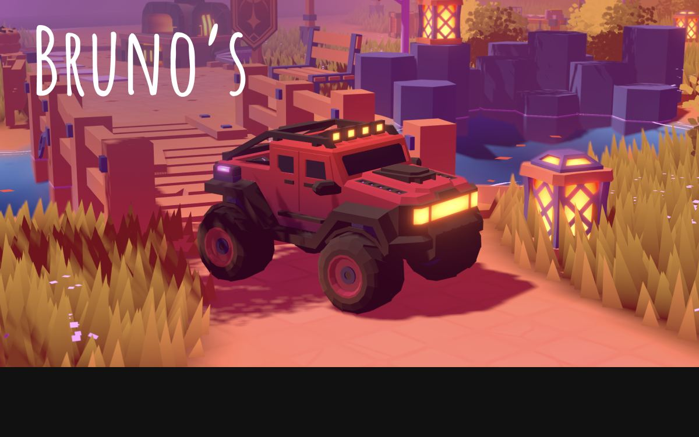
*Site-provided image. My capture showed the loading ring on a purple grid floor; the world didn't finish loading under software WebGL.*

**Purpose & industry:** The portfolio of a French creative developer and Three.js teacher, built as a drivable game world. Developer portfolio and education.

**What makes it distinctive**
- **The portfolio is a game (source + observed text):** Drive a red off-roader through a dusk landscape. Projects, achievements, a time-trial circuit and visitor "whispers" (30-character messages) are places in the world.
- **Influence:** The 2019 version went viral and became a reference point for "playful portfolios." The late-2025 rebuild keeps the concept and moves to WebGPU with a WebGL fallback (Three.js TSL).
- **Generosity (observed):** The page credits its stack and links the **MIT-licensed source code**, Blender files and CC0 music.

**User experience (observed)**
- Excellent controls documentation for **keyboard, touch and gamepad**, plus "I'm stuck!" respawn, a quality toggle and a renderer switch.
- When the score server was offline, the UI said so plainly: "Server currently offline. Scores can't be saved." That's graceful degradation.
- No `<h1>`, 41 of 44 images without `alt`, 14 unnamed controls, ≥7 MB transferred. No non-3D content path.

**Design lessons**
- Give users an escape hatch ("I'm stuck!") in any non-standard interface.
- Document every input method, including touch and gamepad.
- Open-sourcing your build is a design decision: it turns a portfolio into a teaching tool.

**Credits & awards (source):** Bruno Simon, Paris. 2019 version: Awwwards SOTD 11 Nov 2019 (8.04) and **Site of the Month Nov 2019**; CSSDA Website of the Year (research summary). 2025 version: Awwwards SOTD 21 Jan 2026 (8.11; Usability 7.83), Portfolio Honors Dec 2025, **Site of the Month Jan 2026**.

---

### 9. basement.studio — [basement.studio](https://basement.studio)

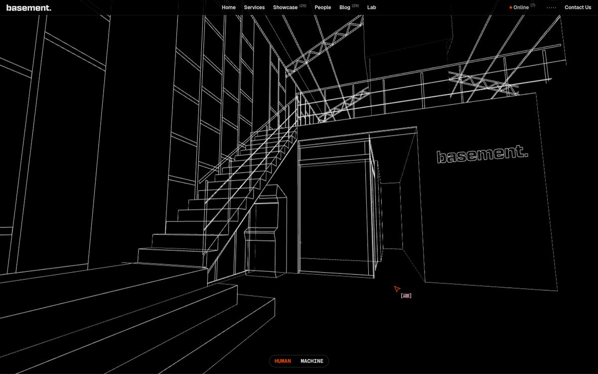
*Observed captures: desktop and mobile.* 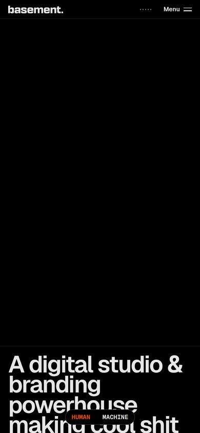

**Purpose & industry:** Studio site for an Argentina-based design and engineering studio working mainly with Bay Area tech companies (Vercel, Linear, Cursor, MrBeast). Creative services.

**What makes it distinctive**
- **Wireframe 3D (observed):** The hero is a white-line wireframe of the studio's own space (stairs, mezzanine, sign). It's 3D, but drawn like an architectural sketch, so it stays monochrome and on-brand.
- **HUMAN / MACHINE toggle (observed):** A pill at the bottom of the viewport. "Machine" links to `/ai/home`, which their `llms.txt` describes as a "plain-HTML mirror of the site for agents; every content page has a twin at /ai/{path}."
- **Live details (observed):** "● Online (7)" presence indicator; superscript counts in the nav (Showcase 26, Blog 29). Typeface is *Geist*, which the studio co-created with Vercel (per its own site).

**User experience (observed)**
- `<main>` and `<nav>` present; reduced-motion CSS present.
- ≥16 MB transferred during the capture window, which is heavy.
- **Mobile bug:** the HUMAN/MACHINE pill overlaps the large headline text at 390 px.

**Design lessons**
- **Ship a plain-HTML twin of an immersive site.** It serves AI agents, but the same idea serves low-power devices, screen-reader users and slow connections.
- Line-art 3D is a cheaper, more distinctive alternative to photoreal rendering.
- Small live numbers (online count, post counts) make a static site feel inhabited.

**Credits & awards (source):** basement.studio, Mar del Plata, Argentina. Current site: Awwwards SOTD 25 Apr 2025 (7.42; Usability 7.13) plus Developer Award (research summary). Earlier versions: SOTD Jun 2022 and HM Jan 2020.

---

### 10. Garden Eight — [garden-eight.com](https://garden-eight.com)

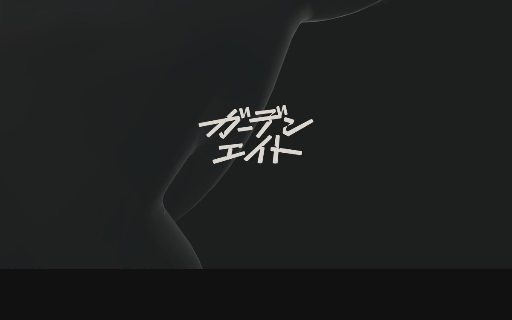
*Site-provided image: the katakana logotype ガーデンエイト over a soft 3D form. My capture rendered only a grey field.*

**Purpose & industry:** Studio site for a Tokyo digital design studio. Creative services.

**What makes it distinctive**
- **Bilingual identity (observed):** English site with a JA switch. The logotype is hand-set katakana, a strong local signature in a global genre.
- **Humble voice (observed):** "Our goal has always been to make a great website in a playful, yet humble way." The page holds only ~460 characters of text, so the copy is sparse and personal.
- **Small UX touch (observed):** The email address has "Copy to clipboard / Copied" feedback.

**User experience (observed)**
- **Zoom disabled.** `<main>`, `<nav>` and one `<h1>` present.
- I couldn't assess the visual experience: the WebGL scene didn't render.
- Unverified: whether the live site is the same version that won the 2022 SOTD.

**Design lessons**
- Let your local script be your logo; it differentiates instantly.
- Click-to-copy beats `mailto:` for many users. Confirm it with a visible state change.

**Credits & awards (source):** Garden Eight, Tokyo. Awwwards SOTD 10 Mar 2022 (7.46; Usability 7.01, the lowest usability score in this set) and SOTD 8 Aug 2017.

---

### Editorial, brand & storytelling

---

### 11. Tengile MalaMala Collection — [tengilemalamala.com](https://tengilemalamala.com)

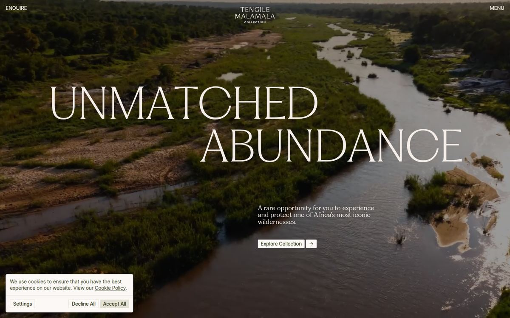
*Observed captures: desktop and mobile.* 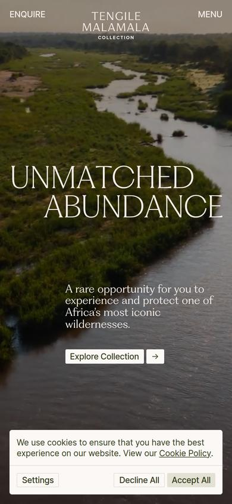

**Purpose & industry:** Safari lodges and camps on the Sand River, Greater Kruger / Sabi Sand, South Africa, with a conservation and community-ownership story. Hospitality, travel, conservation.

**What makes it distinctive**
- **Photography-led (observed):** A full-bleed aerial film of the river. The thin, wide-tracked serif headline "UNMATCHED ABUNDANCE" (*PP Fragment*, with *Inter* for body) is staggered across two lines like a title card.
- **Restrained UI (observed):** Only "ENQUIRE" (left), the logotype (centre) and "MENU" (right), with small paired buttons ("Explore Collection →").
- **Story with substance (observed):** The page traces the land's protection back to 1927 and explains the Shangaan principle *Ntumbuluko* ("deep harmony with the land"). It states community co-ownership and describes itself as "one of South Africa's few black-empowered eco-tourism enterprises."

**User experience (observed)**
- **The most accessible awarded site in this set:** skip link, `<main>`, four `<nav>` landmarks, 21 headings, and `alt` on every image.
- Mobile: the headline re-flows cleanly at 390 px.
- Equal-weight "Decline All / Accept All" cookie choice.
- No reduced-motion CSS detected despite the hero video.

**Design lessons**
- A luxury feel doesn't require heavy WebGL: great footage, one fine serif and silence do the work.
- Pair aspirational imagery with concrete facts (dates, room counts, ownership) to earn trust.
- Award-level craft and solid accessibility basics can coexist; this site proves it.

**Credits & awards (source):** DashDigital (Cape Town, South Africa) with Ingamana. Awwwards SOTD 3 Oct 2026 (7.22; Usability 7.26). Stack per Awwwards: React, Sanity, AWS.

---

### 12. Colonia Zacamil — [coloniazacamil.com](https://coloniazacamil.com)

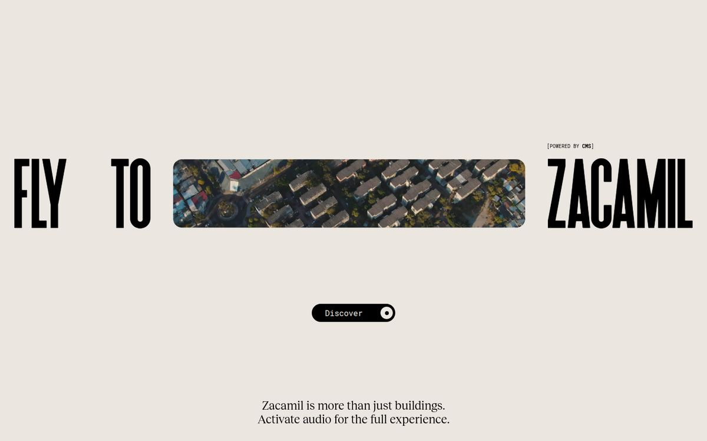
*Observed captures: desktop and mobile.* 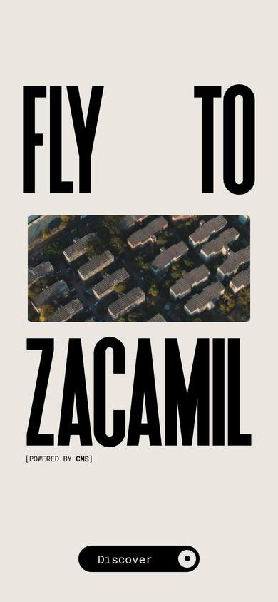

**Purpose & industry:** An interactive map of a public-art and regenerative placemaking project in Colonia Zacamil, Mejicanos, El Salvador (location per CMS Foundation and secondary sources). Curated by the Custom Made Stories Foundation ("[powered by CMS]" on page). Civic, cultural, non-profit.

**What makes it distinctive**
- **Typographic hero (observed):** "FLY TO ZACAMIL" in ultra-condensed black capitals, with an aerial strip of the housing blocks set *inside* the line of type, like a word. *Roboto Mono* labels add a field-notes tone.
- **Map as table of contents (observed):** About 26 named mural and story locations ("Paz y Pachamama", "Cadejo", "Volcano", "The Bus"…) become pins on a 3D model of the neighbourhood.
- **Before/after switch (unverified):** A "past / present" toggle that strips murals off the buildings, described by a design-news article. I didn't confirm it myself.
- **Bilingual (observed):** EN/ES switch, with Spanish titles kept in the English version.

**User experience (observed)**
- Clear gesture instructions for every input: "swipe to explore / click and drag / pinch to zoom / scroll to zoom / click on the pins."
- An audio prompt ("Activate audio for the full experience") rather than autoplay.
- **Zoom disabled**; no headings or landmarks; ≥5.7 MB transferred.
- Mobile: the hero type re-stacks into three bold lines and works well.

**Design lessons**
- Put an image inside a headline line to merge word and place.
- For spatial stories, a map *is* the navigation.
- Write gesture hints for each input type, not just "drag."

**Credits & awards (source):** Adoratorio Studio with 60fps. Awwwards SOTD 1 Oct 2026 (7.58; Usability 7.42); nominated for Business & Services Honors. Stack per Awwwards: Three.js, Vue.js, WebGL. Adoratorio's home country (Italy) is **unverified**.

---

### 13. The Pudding — [pudding.cool](https://pudding.cool)

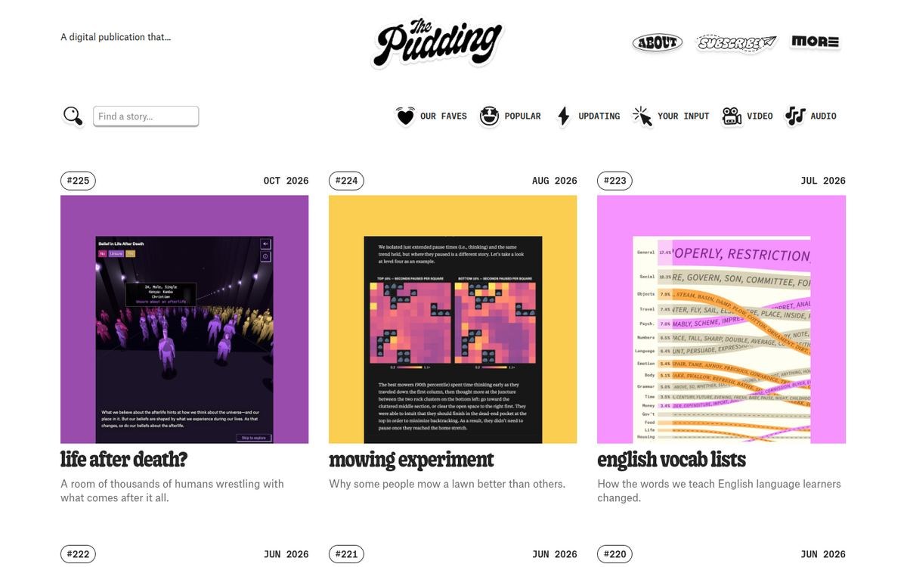
*Observed captures: desktop and mobile.* 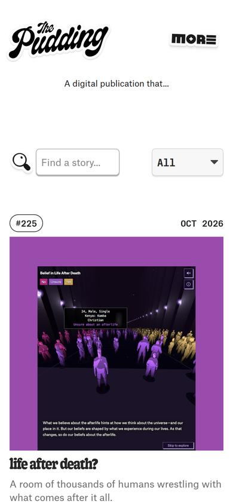

**Purpose & industry:** A digital publication of visual, data-driven essays ("life after death?", "mowing experiment", "english vocab lists"). Journalism and data visualisation.

**What makes it distinctive**
- **Personality (observed):** A retro script logo, sticker-style nav icons (OUR FAVES, POPULAR, UPDATING, YOUR INPUT, VIDEO, AUDIO), and condensed bold headlines (*Gooper SemiCondensed*).
- **Issue numbering (observed):** Each story is numbered (#225, Oct 2026) like a magazine. The archive feels collectible and cumulative.
- **Card thumbnails are mini-previews (observed):** Each tile shows a real frame of the interactive on a saturated colour block.

**User experience (observed)**
- Search box ("Find a story…") and filters in the first viewport. On mobile they collapse to search plus an "All" dropdown.
- Skip link, `<main>`, `<nav>`, reduced-motion CSS. No `<h1>` on the index page.
- Built with Svelte (HTML references).

**Design lessons**
- Number your content; it signals output and invites binge-reading.
- Make thumbnails honest previews of the experience, not stock imagery.
- Category filters named by *behaviour* ("Updating", "Your input") beat topic tags for interactive content.

**Credits & awards (source):** The Pudding (US; founded by Matt Daniels per research summary). Webby Honoree 2019. Information is Beautiful Awards recognition 2024 (research summary).

---

### 14. Bartosz Ciechanowski — [ciechanow.ski](https://ciechanow.ski/mechanical-watch/)

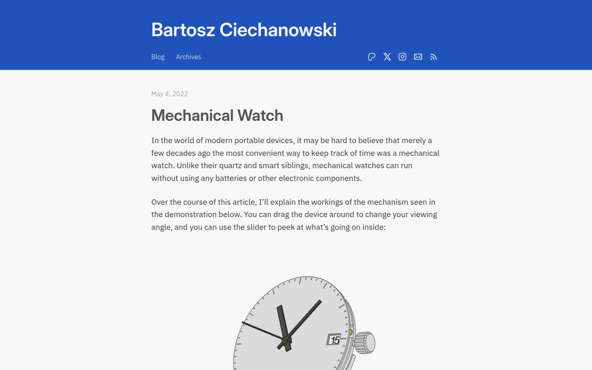
*Observed captures (desktop and mobile): "Mechanical Watch" (4 May 2022).* 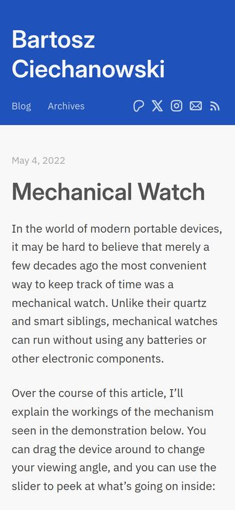

**Purpose & industry:** Long-form interactive explainers (mechanical watches, GPS, cameras, airfoils) by a solo author. Education and science communication.

**What makes it distinctive**
- **Interactivity in service of understanding (observed):** Text and dozens of inline 3D diagrams alternate. Readers drag to rotate, scrub sliders and toggle states. Each figure answers exactly the question the previous paragraph raised.
- **Radical plainness (observed):** A blue header bar, a ~650 px reading column, *Inter*, a date and title. No hero, no ads, no pop-ups.
- **Scale (observed):** ~46,000 characters of text on one page; 14 section `<h1>`s.

**User experience (observed)**
- Superb readability on desktop and mobile; the column becomes full-width with comfortable line length.
- The article tells readers how to use the first figure ("You can drag the device around… use the slider to peek inside").
- 13 images without `alt`, no landmarks, 13 unnamed controls, and no reduced-motion CSS (the author offers a global pause instead, per page text).

**Design lessons**
- Interactivity is best when it's *explanatory*: one concept per figure, placed right after the sentence that needs it.
- A boring frame lets extraordinary content shine.
- Teach the interaction once, early, in plain words.

**Credits & awards (source):** Bartosz Ciechanowski (Polish, per secondary source). **No awards verified**; its influence is widely cited informally.

---

### 15. Ableton Learning Synths — [learningsynths.ableton.com](https://learningsynths.ableton.com)

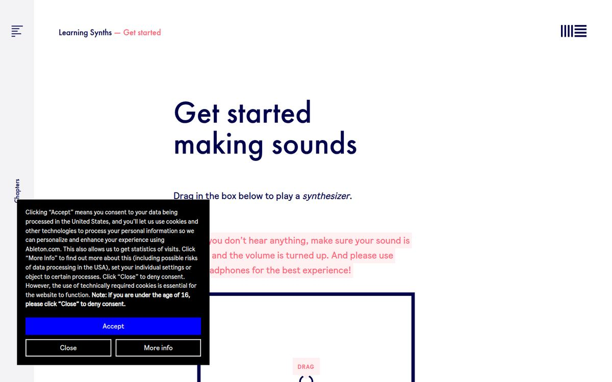
*Observed captures, desktop and mobile (cookie banner visible).* 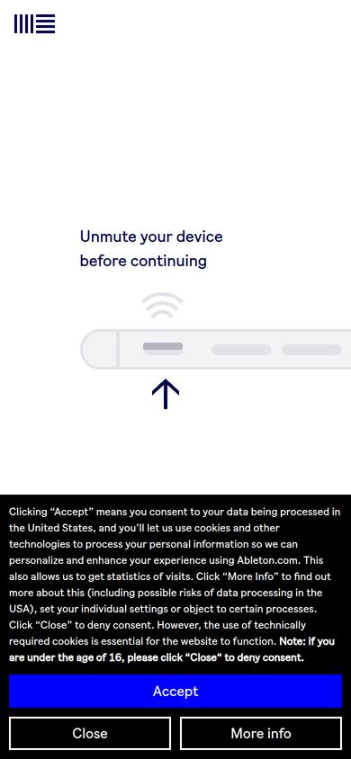

**Purpose & industry:** A free, interactive course on how synthesizers work, from the Berlin music-software company. Education and music technology.

**What makes it distinctive**
- **Learn by doing in the first viewport (observed):** "Get started making sounds. Drag in the box below to play a synthesizer." The very first interaction is the lesson.
- **Visual language (observed + site image):** Big geometric sans (*Ableton Sans*), navy text on white, coral highlights, and a set of colourful waveform shapes (triangle, saw, square, sine) as illustration.
- **Mobile empathy (observed):** On iPhone emulation it shows "Unmute your device before continuing" with a drawing of the phone's mute switch. A real-world failure mode, designed for.

**User experience (observed)**
- A "Chapters" side rail on desktop; a hamburger on mobile.
- **Zoom disabled.**
- WebFetch (no JS) got only "Your browser does not support this site," so there's no non-JS fallback.

**Design lessons**
- Make the first interaction the core value. No intro, no marketing.
- Anticipate the physical context (mute switch, headphones, volume) and design a friendly preflight screen.
- Use simple geometric illustration that literally depicts the concept (waveforms).

**Credits & awards (source):** Ableton, Berlin. Sibling site Learning Music: Awwwards Honorable Mention 29 May 2017. Learning Synths launched 2019, team led by Dennis DeSantis, sound engine built with Cycling '74 RNBO (research summary; unverified).

---

### 16. Teenage Engineering — [teenage.engineering](https://teenage.engineering)

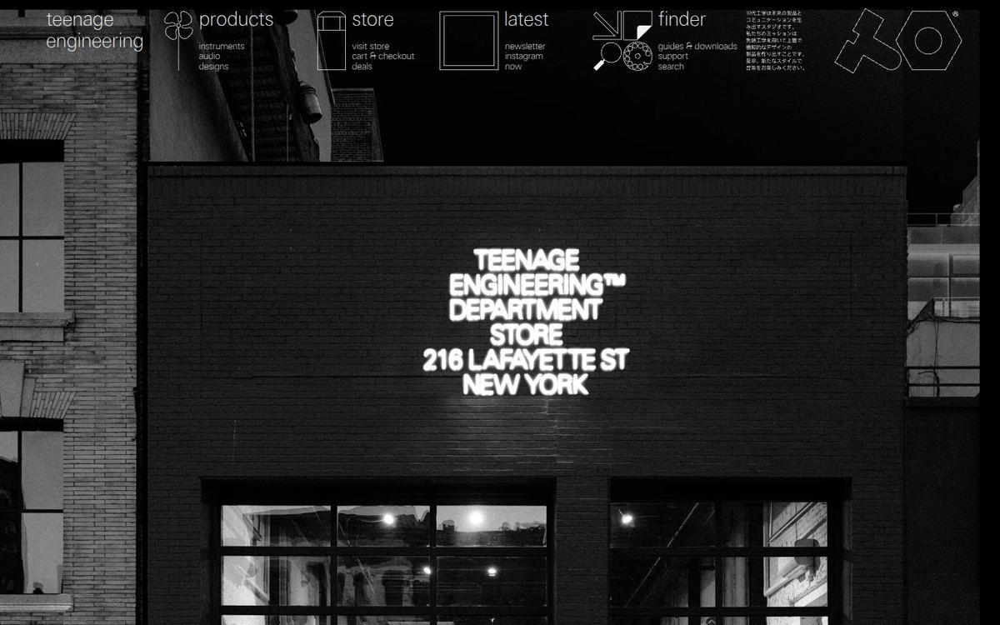
*Observed captures: desktop and mobile.* 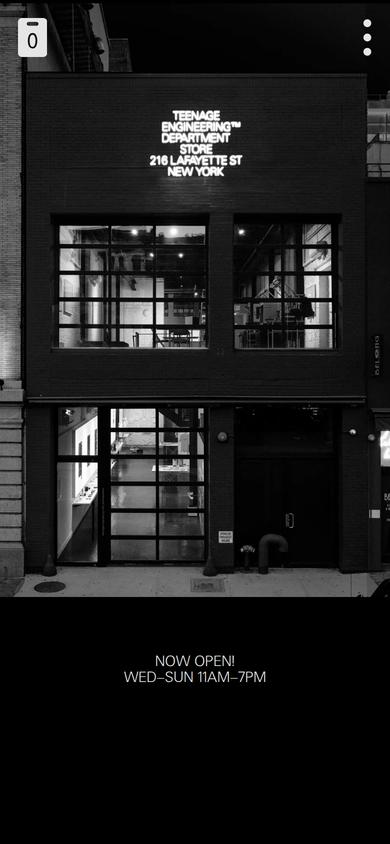

**Purpose & industry:** Brand and store for the Stockholm maker of synthesizers and design objects (OP-1, Pocket Operators). Consumer electronics and retail.

**What makes it distinctive**
- **Monochrome industrial (observed):** Black-and-white night photograph of the new New York store, with a neon sign reading "TEENAGE ENGINEERING™ DEPARTMENT STORE 216 LAFAYETTE ST NEW YORK."
- **Navigation as product labelling (observed):** A strip of thin line pictograms, each with a lowercase word and small sub-links (products: instruments · audio · designs; store; latest; finder). Alongside sits a dense block of tiny Japanese text, like the spec plate on one of their devices.
- **Custom type (observed):** The DOM uses the in-house font *te-20*; the copy is all lowercase.

**User experience (observed)**
- Very light page. Reduced-motion CSS present.
- **Zoom disabled**; no `<h1>`.
- Mobile reduces to a cart counter, a kebab menu, the photo and "NOW OPEN! WED–SUN 11AM–7PM." It's clear, if spare.

**Design lessons**
- Let your website look like your product (labels, pictograms, spec plates).
- One monochrome photograph plus precise micro-typography can out-brand any animation.
- Sub-links under top-level nav items reduce clicks without mega-menus.

**Credits & awards (source):** Teenage Engineering (Stockholm, from the site footer). **Site designer and awards unverified.**

---

### Product & utility

---

### 17. Linear — [linear.app](https://linear.app)

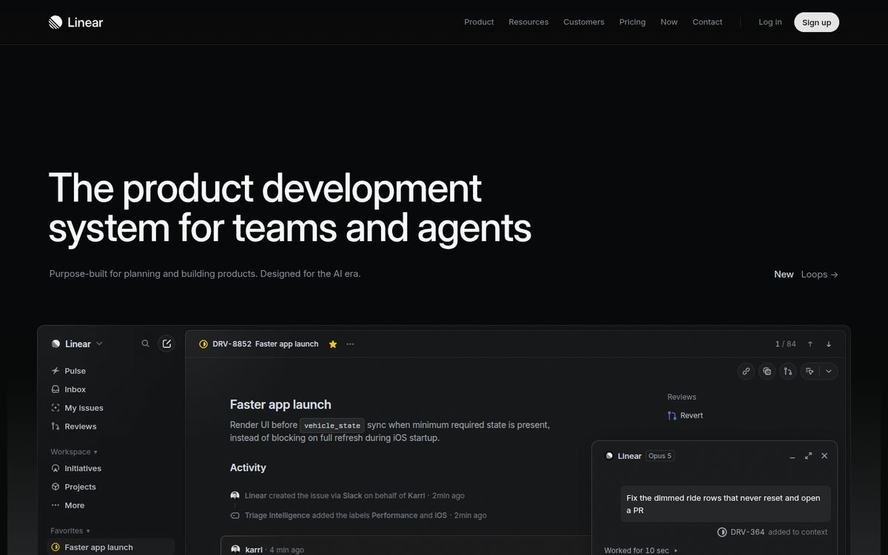
*Observed captures: desktop and mobile.* 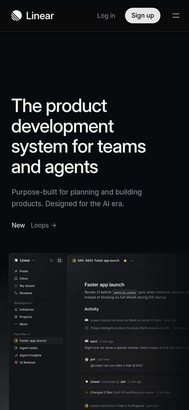

**Purpose & industry:** Marketing site for a product-development and issue-tracking tool, now positioned "for teams and agents." B2B SaaS.

**What makes it distinctive**
- **The product is the hero (observed):** Under "The product development system for teams and agents" sits a pixel-accurate rendering of the actual app: sidebar, issue, activity feed and an AI agent panel.
- **Precision dark aesthetic (observed):** Near-black background, grey secondary text, a white pill CTA. *Inter Variable* for UI and *Berkeley Mono* for technical labels, plus "FIG 0.1"-style captions under isometric line drawings, like a technical manual.
- **Two-tone headlines (observed):** A white statement followed by a grey continuation ("A new species of product tool. Purpose-built for…"). It's a common SaaS pattern now; Linear's execution is very tight.

**User experience (observed)**
- Skip link, `<main>`, two `<nav>` landmarks, reduced-motion CSS. About 9,000 characters of real content.
- Excellent mobile layout: the headline scales and the product UI crops gracefully.

**Design lessons**
- Show your actual interface, at real fidelity, above the fold.
- Use a monospace "spec" voice for captions and labels to signal engineering rigour.
- Two-tone headline/sub-head pairs let one sentence do the work of two.

**Credits & awards (source):** Linear (in-house). **No awards verified.** Linear has published design write-ups on its 2024 UI redesign (research summary).

---

### 18. Stripe — [stripe.com](https://stripe.com)

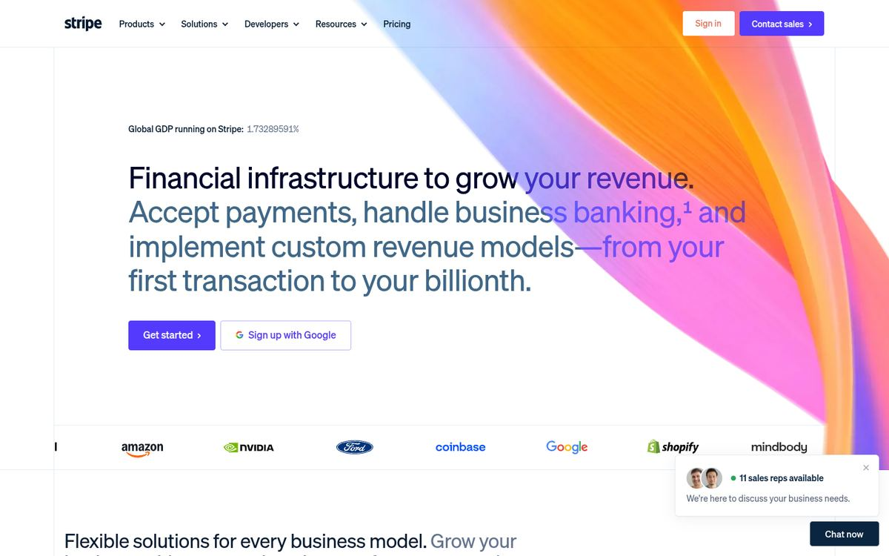
*Observed captures: desktop and mobile.* 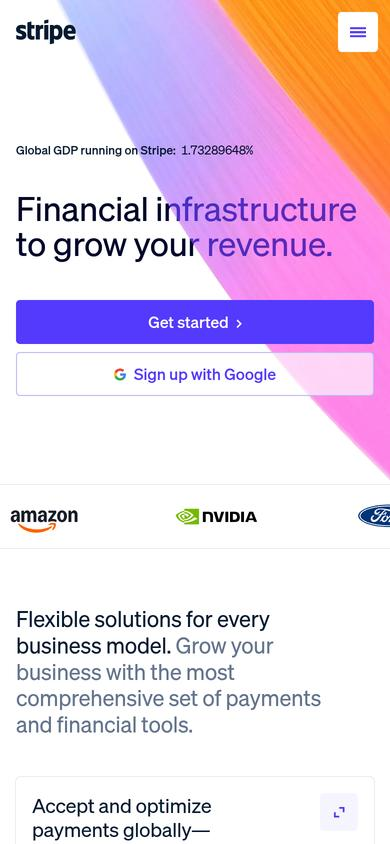

**Purpose & industry:** Homepage for the payments and financial infrastructure company. Fintech, B2B.

**What makes it distinctive**
- **The gradient ribbon (observed):** A flowing orange-pink-violet band sweeps across the hero. It's the most-imitated SaaS visual of the last decade, and still distinctive here because it's paired with very sober typography (*Söhne Variable*).
- **Live data as headline (observed):** "Global GDP running on Stripe: 1.73289591%", a ticking figure that makes an abstract claim concrete.
- **Hierarchy (observed):** The headline sets its first clause in dark ink and the continuation in slate blue. Primary and secondary CTAs ("Get started", "Sign up with Google") are clearly ranked.

**User experience (observed)**
- Mega-menu navigation (Products, Solutions, Developers, Resources, Pricing). The mobile hamburger keeps both CTAs full-width.
- A sales-chat pop-up ("11 sales reps available") appears over content on desktop.
- Two `<h1>` elements; no reduced-motion CSS detected despite the animated hero.

**Design lessons**
- One signature visual plus disciplined type can define a brand.
- Turn a big claim into a live, specific number.
- Rank your CTAs visually: one filled, one outlined.

**Credits & awards (source):** Stripe (in-house). Stripe.com is listed as an Awwwards nominee only. The separate Stripe Dot Dev site won Awwwards SOTD 9 Oct 2024 (7.43).

---

### 19. GOV.UK — [gov.uk](https://www.gov.uk)

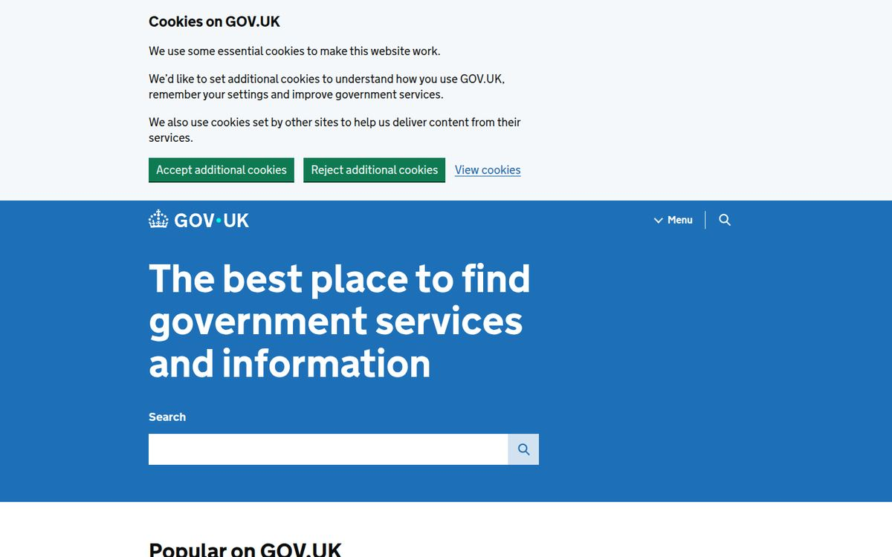
*Observed captures, desktop and mobile (cookie banner shown on first visit).* 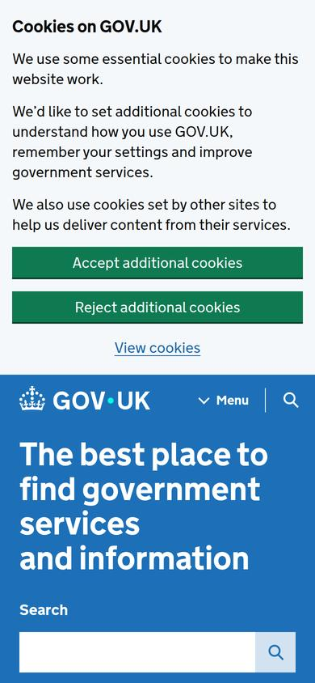

**Purpose & industry:** The single domain for UK government services and information. Public sector. **Included deliberately as the counterweight to visual complexity.**

**What makes it distinctive**
- **Utility as identity (observed):** One typeface (*GDS Transport*), one blue, one black, and a giant plain-English headline ("The best place to find government services and information"), with search as the primary action.
- **Influence (source):** Its design principles and open-source design system (GOV.UK Frontend) have shaped public-sector design worldwide.

**User experience (observed)**
- The lightest page measured in the set (≥0.2 MB). Skip link, landmarks, reduced-motion CSS.
- **Cookie banner with equal "Accept additional cookies" / "Reject additional cookies" buttons**, plus "View cookies."
- Mobile is effectively identical in hierarchy, just narrower.

**Design lessons**
- Write the headline as the user's goal, not your brand promise.
- Search-first is a design style. For content-heavy sites it often beats navigation menus.
- Consistency (one font, one blue, one button style) is a brand.

**Credits & awards (source):** Government Digital Service. Launched 2012. **Design Museum Design of the Year 2013** (overall and digital category).

---

### 20. Poolsuite — [poolsuite.net](https://poolsuite.net)

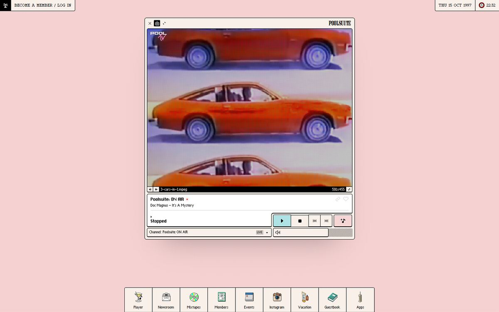
*Observed captures: desktop and mobile.* 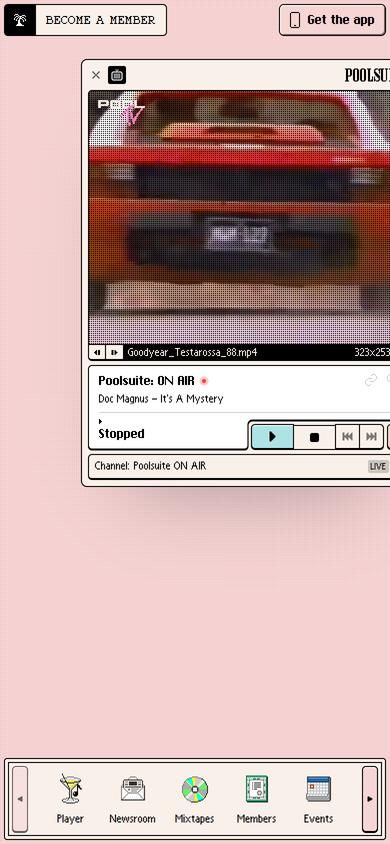

**Purpose & industry:** A summer-themed internet radio and lifestyle brand (formerly Poolside.FM). Music, media, membership.

**What makes it distinctive**
- **Retro-OS metaphor (observed):** A late-'90s Mac-style desktop in pale pink. A windowed player shows grainy "Pool TV" car-commercial footage, a "Poolsuite: ON AIR" channel and transport buttons. A dock holds Player, Newsroom, Mixtapes, Members, Events, Instagram, Vacation, Guestbook, Apps.
- **Playful detail (observed):** The menu-bar clock reads today's date in **1997** ("THU 15 OCT 1997"). Fonts include a bitmap-style face (*Ishmeria*).
- **Commitment to the bit:** Every feature is an "app" in the fake OS, so the metaphor is the information architecture.

**User experience (observed)**
- On desktop the metaphor is instantly understood.
- **Mobile bug:** the player window is clipped off the right edge at 390 px (no page-level overflow was flagged, so it's cropped inside a container).
- 73 of 133 images lack `alt`, 11 unnamed controls, no `<h1>`, no reduced-motion CSS.

**Design lessons**
- A strong nostalgic metaphor can double as your IA (apps = sections).
- Tiny jokes (the 1997 clock) create affection and shareability at zero cost.
- Retro desktop metaphors need a genuine mobile re-think, not just scaling.

**Credits & awards (source):** Founded by Marty Bell; standalone site since 2019 (research summary). Product Hunt Golden Kitty 2020 for the iPhone app and Launch of the Day 2021. **No web-design awards verified; creator's country unverified.**

---

## 3. Top five selections

Criteria: originality **and** how well the design serves its purpose, weighted against observed usability and accessibility. Awards were a tiebreaker, not a driver.

| Rank | Site | Why it makes the top five |
|---|---|---|
| **1** | **Bartosz Ciechanowski** | The purest example of interaction serving understanding. Every figure exists because a sentence needed it, inside a frame so plain it disappears. No award needed: it changes what readers *know*. Accessibility of the figures is the one gap. |
| **2** | **Tengile MalaMala Collection** | Shows award-level beauty **and** the strongest accessibility basics among awarded sites (skip link, landmarks, alt text, equal cookie choice). It proves you don't need 15 MB of WebGL to feel luxurious. Footage, a fine serif and silence do it. |
| **3** | **Lando Norris** | The year's top award winner, and it earns it on fundamentals: a memorable two-typeface wordmark, a single accent colour reserved for commerce, a live "next race" module, and a clear person → performance → store narrative. Its alt-text coverage is complete. |
| **4** | **basement.studio** | Combines a distinctive wireframe aesthetic with the single most forward-looking idea in the collection: a **HUMAN / MACHINE** switch to a plain-HTML twin of every page. It's heavy, and the toggle overlaps text on mobile, but the concept is worth stealing. |
| **5** | **Ableton Learning Synths** | Makes the first interaction the lesson, and designs for the physical world ("unmute your device"). A model for any product that needs to teach. |

**Honourable mentions:** **Linear** (best product-as-hero), **Colonia Zacamil** (map-as-navigation and type-as-image, for a civic cause), **GOV.UK** (the benchmark for clarity), and **Messenger** (the most delightful pure experiment, held back by having no text layer at all).

**Why not Igloo, Immersive Garden or Lusion in the top five?** They are visually extraordinary and heavily awarded. But in observed terms they ship empty or near-empty HTML (Igloo), lack image alt text (Immersive Garden), disable zoom (Lusion, Immersive Garden), and are among the heaviest pages tested. Visual complexity is not the same as good design.

---

## 4. The strongest design ideas across the collection

1. **Make the first interaction the value.** Ableton's playable box, Linear's real UI, Ciechanowski's draggable watch. Nobody waits for a pitch.
2. **One accent, used once.** Lando's lime STORE button, Scout's red "+" joint, Locomotive's copper headline. Scarcity makes colour mean something.
3. **Two typefaces with opposite personalities.** Serif + grotesk (Lando, Locomotive, Immersive Garden), sans + mono (Linear, Zacamil, Igloo). The contrast does the branding.
4. **Live, specific data as a headline.** Stripe's GDP counter, Lando's next race, basement's "Online (7)," Teenage Engineering's store hours.
5. **A single strong metaphor that doubles as navigation.** Poolsuite's desktop (apps = sections), Zacamil's map (pins = stories), Bruno's world (places = projects), Messenger's planet.
6. **Stylised over photoreal 3D.** Toon shading (Messenger), wireframe (basement), toy-like plastic (Lusion). More distinctive, more legible, and usually lighter.
7. **Loaders as the first scene.** Igloo's ASCII bar, Lusion's giant counter, Immersive Garden's serif line with percentage.
8. **A plain-HTML twin for immersive sites.** basement's `/ai/` mirror. Generalise it to a text, low-power or accessible mode.
9. **Design for the physical context.** Ableton's mute-switch prompt; Bruno's keyboard, touch and gamepad docs, plus "I'm stuck!"
10. **Honesty builds trust.** Scout's pricing and timing caveats next to the claim; equal-weight cookie choices (Scout, Tengile, GOV.UK); Bruno's "server offline" message.

### Recurring weaknesses to avoid (observed)

- **Disabling pinch-zoom** (6 of 20 sites: Lusion, Immersive Garden, Garden Eight, Zacamil, Ableton, Teenage Engineering).
- **Missing text alternatives**: Igloo and Messenger render no DOM text at all; Immersive Garden, Bruno Simon and Poolsuite leave most images without `alt`.
- **No reduced-motion handling detected** on 13 of 20 sites, including most of the motion-heavy ones. (Cross-origin stylesheets can't be inspected, so a few may handle it in ways I couldn't see.)
- **Weight**: several WebGL sites transferred 5–21 MB within the first ~35 seconds.
- **Award juries agree, quietly.** For every awarded site with published Awwwards scores, **Usability was the lowest or second-lowest sub-score**, and in most cases the lowest.

---

## 5. Things I could not verify

- **Real-device rendering and speed** of the heavy WebGL sites (Igloo, Bruno Simon, Garden Eight, Lando's 3D layer, Immersive Garden's case-study scenes). My renderer had no GPU.
- **Colonia Zacamil's "past/present" switch** (reported by a design-news article; not observed by me).
- **Lusion's FWA Site of the Year and Cannes Lions 2024 awards** (LinkedIn only). The CSSDA WOTY 2023 is only partially confirmed.
- **Scout Motors' Webby and Idéa awards**, The Pudding's 2024 Information is Beautiful recognition, and Bruno Simon's 2019 CSSDA WOTY (research summary; not rechecked).
- **Countries** for Adoratorio (Italy?), Poolsuite's creator, and Ciechanowski (Poland, secondary source).
- **Whether Garden Eight's live site** is the same version that won SOTD in 2022.
- **Teenage Engineering's and Linear's site designers**, and any awards for them.
- **Opal Tadpole** (E-commerce of the Year 2024) is no longer accessible and was excluded.

---

## Sources

**Award platforms (primary)**
- Awwwards Hall of Fame 2025 — https://www.awwwards.com/annual-awards/hall-of-fame/2025
- Awwwards Hall of Fame 2024 — https://www.awwwards.com/annual-awards/hall-of-fame/2024
- Awwwards Sites of the Year — https://www.awwwards.com/websites/sites_of_the_year/
- Awwwards Sites of the Day — https://www.awwwards.com/websites/sites_of_the_day/
- Lando Norris — https://www.awwwards.com/sites/lando-norris
- Messenger — https://www.awwwards.com/sites/messenger
- Igloo Inc — https://www.awwwards.com/sites/igloo-inc
- Opal Tadpole — https://www.awwwards.com/sites/opal-tadpole
- Lusion v3 — https://www.awwwards.com/sites/lusion-v3
- Scout Motors — https://www.awwwards.com/sites/scout-motors
- Bruno Simon Portfolio (2019) — https://www.awwwards.com/sites/bruno-simon-portfolio
- Bruno's Portfolio (2025) — https://www.awwwards.com/sites/brunos-portfolio
- Bruno's Portfolio case study — https://www.awwwards.com/brunos-portfolio-case-study.html
- Bruno Simon SOTM Nov 2019 — https://www.awwwards.com/bruno-simon-portfolio-wins-site-of-the-month-november.html
- Bruno Simon profile — https://www.awwwards.com/bruno.simon/submissions
- basement studio (2025) — https://www.awwwards.com/sites/basement-studio-3
- basement studio (2022) — https://www.awwwards.com/sites/basement-studio-1
- basement studio profile — https://www.awwwards.com/basementstudio/
- Garden Eight (2022) — https://www.awwwards.com/sites/garden-eight
- Garden Eight (2017) — https://www.awwwards.com/sites/garden-eight-1
- Tengile MalaMala Collection — https://www.awwwards.com/sites/tengile-malamala-collection
- Colonia Zacamil — https://www.awwwards.com/sites/colonia-zacamil
- Learning Music (Ableton) — https://www.awwwards.com/sites/learning-music-ableton
- Stripe Dot Dev — https://www.awwwards.com/sites/stripe-dot-dev
- Agency profiles: https://www.awwwards.com/locomotive/ · https://www.awwwards.com/offbrand/ · https://www.awwwards.com/abeto/ · https://www.awwwards.com/dashdigital/
- CSSDA, Lusion v3 — https://www.cssdesignawards.com/sites/lusion-v3/44591/
- Design Museum, Designs of the Year — https://designmuseum.org/exhibitions/beazley-designs-of-the-year

**Creator and project sources**
- basement.studio `llms.txt` — https://basement.studio/llms.txt (describes the `/ai/` plain-HTML mirror)
- Bruno Simon source code (MIT) — https://github.com/brunosimon/folio-2025
- CMS Foundation projects (Zacamil) — https://cms.foundation/our-projects
- Dokle, "Colonia Zacamil puts a past-present switch on a 3D map" (secondary) — https://dokle.design/awards/colonia-zacamil-past-present-switch-3d-map

**Secondary (used only where marked "unverified")**
- Lusion's Cannes Lions / FWA claims via LinkedIn posts by Lusion and Edan Kwan (2024)
- Opal Tadpole E-commerce of the Year via LinkedIn posts by Claudio Guglieri and Ingamana (2025)

**Firsthand inspection:** All 20 live sites (plus `op.al`), visited 15 Oct 2026 with headless Chrome, curl and text extraction. Screenshots are in `images/`.
